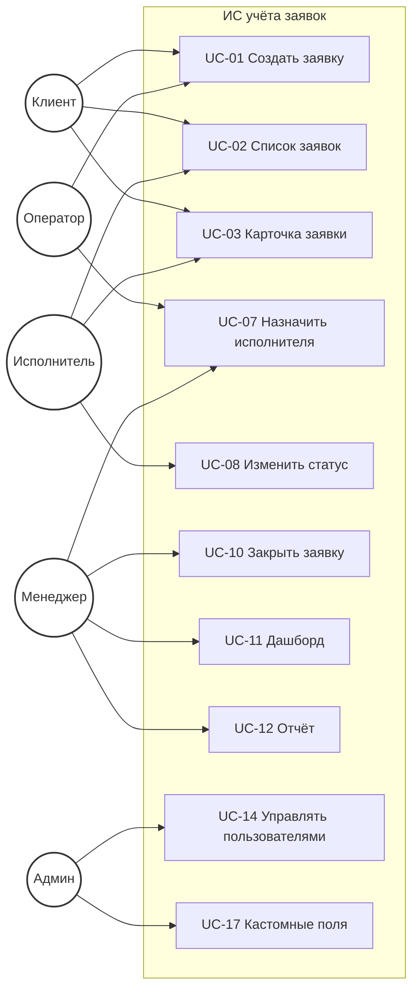
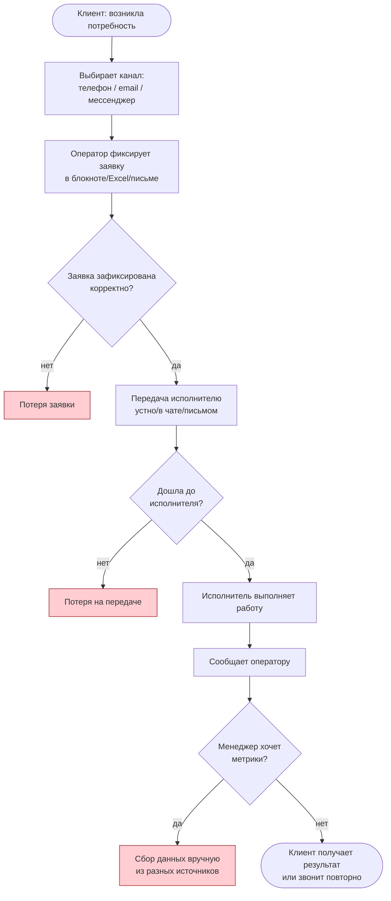
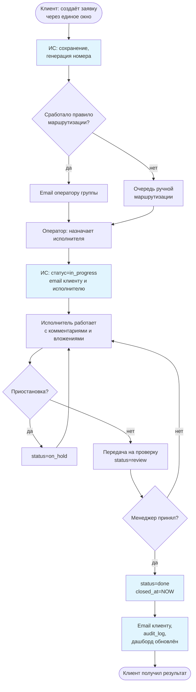
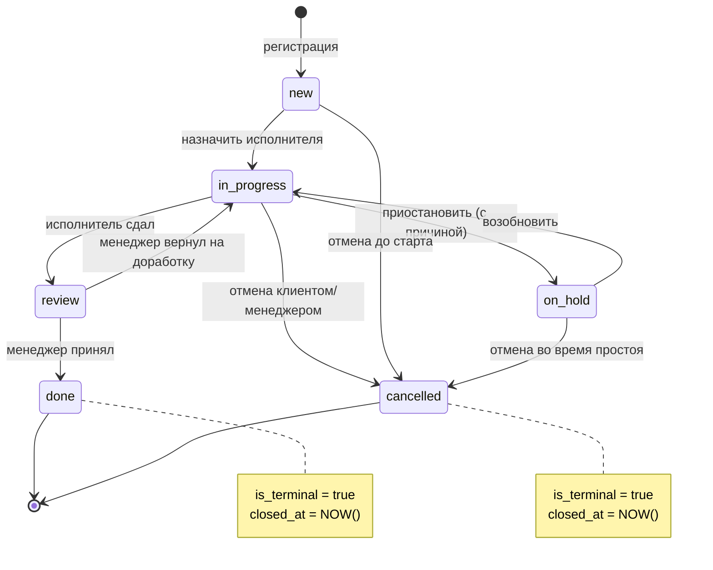

# Диаграммы для ВКР

В папке лежат исходники четырёх диаграмм в формате **PlantUML** (`.puml`):

| Файл | Что показывает | Глава ВКР |
|---|---|---|
| `use_case.puml` | Диаграмма вариантов использования (UML Use Case) | 2.2.1 |
| `bpmn_as_is.puml` | Бизнес-процесс «AS-IS» (до внедрения ИС) | 1.3.2 |
| `bpmn_to_be.puml` | Бизнес-процесс «TO-BE» (после внедрения ИС) | 1.4.1 / 2.2.3 |
| `activity_request_lifecycle.puml` | Диаграмма деятельности — жизненный цикл заявки | 2.2.3 |

## Как получить картинки (PNG/SVG) для вставки в DOCX

### Способ 1 — онлайн-сервис PlantUML (быстрее всего)
1. Открыть https://www.plantuml.com/plantuml/uml
2. Скопировать содержимое `.puml`-файла в текстовое поле.
3. Внизу выбрать формат: **PNG** или **SVG**.
4. Скачать и вставить в Word (`Вставка → Рисунок`).

### Способ 2 — VS Code с расширением PlantUML
1. Установить расширение **PlantUML** (jebbs.plantuml).
2. Открыть `.puml`-файл, нажать `Alt+D` — превью.
3. `Ctrl+Shift+P` → **PlantUML: Export Current Diagram** → выбрать PNG.
4. Файл будет сохранён рядом.

### Способ 3 — локально через JAR
```bash
# скачать plantuml.jar один раз с plantuml.com/download
java -jar plantuml.jar -tpng artifacts/03_diagrams/*.puml
# результат - .png рядом с .puml
```

## Альтернатива — Mermaid (рендерится прямо на GitHub)

Ниже — те же диаграммы в Mermaid-версии. GitHub отрисует их в превью этого README автоматически. Также можно открыть https://mermaid.live для редактирования.

### 1. Use Case (упрощённый, в нотации Mermaid `flowchart`)



### 2. AS-IS процесс



### 3. TO-BE процесс



### 4. Жизненный цикл заявки (state machine)



## Какой формат выбрать

- **Для самой ВКР (DOCX)** — рендерить PlantUML-исходники в **PNG** через plantuml.com и вставлять как рисунки. Это даёт максимально презентабельный вид и гибкость стилей.
- **Для черновой работы и обсуждения** — Mermaid в `.md`-файле в репозитории, GitHub показывает их сразу.
- **При защите (на слайдах)** — лучше тоже PNG/SVG из PlantUML.
